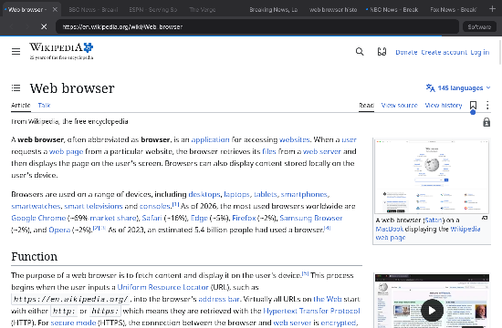

# Surfer on WebKit: performance before and after

The second round (frames at the rate the picture changes, video, the advertising filter, two
processors) is in [round-2.md](round-2.md).
WebKit 2.54.3 against 2.40.5, the engine ICDA shipped before: [round-3.md](round-3.md).

Before: `6b27adf`, the commit before this work (ICDA 1.10.3's code). After: frame pacing, partial window updates and memory
management in `userspace/webkit/browser.c` and `userspace/gui.c`, and live `/proc` in the kernel
(`kernel/linux/lx.c`, `lx_vm.c`, `kernel/memory/vmm.c`).

Measured with `tests/webkit-bench` (see its README): the real `browser.c` and `gui.c` built against
the WPE WebKit 2.40.5 ICDA ships, Mesa's software renderer, ICDA's window manager and `/proc`
emulated, on a 4-core Linux host. Real sites were loaded live; both builds ran alternately and the
tables show medians (3 runs per page, 2 for navigation and tabs). Not measured on ICDA hardware,
and the GPU path was not run.

## Summary

| | Before | After |
|---|---:|---:|
| CPU on 7 idle sites, together | 7.70 cores | 5.16 cores (−33%) |
| Kernel-lock entries on those sites | 160.5K /s | 90.5K /s (−44%) |
| Web processes after 6 sites in a tab | 8 | 5 (1.5 GB, was 2.0 GB) |
| Crashes with 8 heavy tabs on 4 GB | 2 | 0 (over 2 runs each) |

## Idle page (15 s after loading)

Kernel-lock entries are system calls plus page faults: on ICDA each one takes the kernel's single lock.

| Page | Cores before | after | Kernel-lock entries/s before | after | Frames from WebKit/s before | after | Visible updates/s before | after |
|---|---:|---:|---:|---:|---:|---:|---:|---:|
| Animation under a banner (test) | 2.06 | 0.20 | 33,044 | 2,787 | 203.3 | 13.3 | 0.0 | 0.0 |
| Small visible animation (test) | 2.03 | 0.65 | 36,324 | 11,326 | 203.3 | 60.0 | 157.0 | 57.0 |
| Canvas redrawn each frame (test) | 2.10 | 0.59 | 33,655 | 9,907 | 223.3 | 60.0 | 225.5 | 62.0 |
| Video at 30 frames/s (test) | 0.49 | 0.48 | 7,367 | 7,014 | 30.0 | 30.0 | 30.4 | 30.3 |
| Static page (test) | 0.01 | 0.00 | 261 | 265 | 0.0 | 0.0 | 0.0 | 0.0 |
| Tab not shown: repaint (test) | 0.01 | 0.01 | 324 | 330 | 0.0 | 0.0 | – | – |
| Tab not shown: compositor (test) | 0.01 | 0.01 | 324 | 328 | 0.0 | 0.0 | – | – |
| Wikipedia article | 1.91 | 0.46 | 45,410 | 10,253 | 183.3 | 40.0 | 68.7 | 23.0 |
| BBC News | 0.12 | 0.08 | 5,921 | 2,252 | 3.3 | 3.3 | 0.0 | 0.0 |
| CNN | 2.96 | 3.07 | 37,674 | 37,414 | 33.3 | 33.3 | 16.1 | 16.3 |
| The Verge | 0.10 | 0.09 | 6,452 | 2,398 | 0.0 | 0.0 | 0.0 | 0.0 |
| ESPN | 0.45 | 0.33 | 16,949 | 12,895 | 13.3 | 6.7 | 0.5 | 0.4 |
| YouTube search results | 0.04 | 0.04 | 1,444 | 1,176 | 0.0 | 0.0 | 0.0 | 0.0 |
| NBC News | 2.12 | 1.10 | 46,647 | 24,140 | 130.0 | 60.0 | 130.5 | 44.3 |

The two "tab not shown" rows have an animated page in a tab behind a static one; WebKit stops
drawing it in both builds.

## Scrolling (10 s of mouse wheel: 20 notches a second, down for 6 s, back up for 4)

| Site | Cores before | after | change | Visible updates/s before | after |
|---|---:|---:|---:|---:|---:|
| Wikipedia article | 1.96 | 0.79 | −60% | 24.5 | 21.1 |
| BBC News | 2.21 | 0.82 | −63% | 24.3 | 22.5 |
| CNN | 2.97 | 3.06 | +3% | 13.3 | 13.8 |
| The Verge | 2.23 | 1.63 | −27% | 26.7 | 24.3 |
| ESPN | 1.44 | 1.33 | −8% | 20.2 | 19.0 |
| YouTube search results | 1.58 | 1.40 | −11% | 26.9 | 24.7 |
| NBC News | 2.82 | 2.54 | −10% | 55.3 | 39.6 |

## Wheel to screen

Milliseconds from a wheel notch to the page moving on screen, on the long test page.

| | Before | After |
|---|---:|---:|
| Typical notch (median) | 7.6 ms | 7.7 ms |
| Slow notch (95th percentile) | 12.1 ms | 14.6 ms |

The long test page, 20 notches a second for 10 s, 3 runs per build (the median of the runs). A paced frame can wait for the display's next 60th of a second, so the slowest notches arrive up to a few milliseconds later; the typical notch is unchanged.

## Load time (seconds to WebKit's load finished)

| Site | Before | After |
|---|---:|---:|
| Wikipedia article | 4.3 | 4.4 |
| BBC News | 6.0 | 4.9 |
| CNN | 8.5 | 7.3 |
| The Verge | 11.4 | 9.1 |
| ESPN | 5.3 | 5.3 |
| YouTube search results | 4.3 | 4.6 |

## Six sites, one after another, in one tab (emulated 8 GB)

| After visiting | Web processes before | after | Memory before | after |
|---|---:|---:|---:|---:|
| Wikipedia | 1 | 1 | 0.33 GB | 0.33 GB |
| BBC News | 3 | 3 | 0.52 GB | 0.53 GB |
| ESPN | 4 | 4 | 0.94 GB | 0.90 GB |
| The Verge | 5 | 4 | 1.48 GB | 1.34 GB |
| CNN | 6 | 4 | 1.83 GB | 1.63 GB |
| YouTube | 8 | 5 | 2.01 GB | 1.51 GB |

## Eight heavy tabs on a 4 GB machine

The browser was limited to 3.3 GB (4 GB less 700 MB for the kernel and desktop); past it a process is
ended, as ICDA's kernel does when no page is left. Each run separated by /.

| | Before | After |
|---|---|---|
| Out-of-memory kills | 1 / 1 | 0 / 0 |
| Pages that crashed | 1 / 1 | 0 / 0 |
| Tabs discarded | 0 / 0 | 4 / 4 |
| Most memory used | 3.49 GB / 3.49 GB | 3.09 GB / 3.12 GB |
| CPU with all tabs open, idle | 2.22 cores / 2.16 cores | 1.08 cores / 1.11 cores |
| First tab shown again after | kept in memory / kept in memory | reloaded in 3.9 s / reloaded in 4.0 s |

## Kernel self-test inside ICDA (QEMU)

`userspace/nptestlx.c` with the new `/proc` checks, built into both kernels (`CI_SELFTEST=1
CI_IMAGE=1`, `icda.test=nptestlx`) and booted in QEMU.

| Check | ICDA 1.10.3 kernel | Fixed kernel |
|---|---|---|
| /proc/self/statm exists | **fail** | pass |
| pread on /proc/self/statm | not reached | pass |
| statm follows memory use (4 MB touched, read again) | not reached | pass |
| MemAvailable counts free memory at least | pass | pass |
| /proc/meminfo follows memory use after a rewind (16 MB) | **fail** | pass |
| /proc/self/status has Threads and RssAnon | **fail** | pass |
| /proc/self lists statm | **fail** | pass |
| The 30 older checks | 27 pass, 3 fail | 27 pass, 3 fail |

The three older failures (`mprotect W|X -> EINVAL`, `mprotect unmapped -> ENOMEM`, `munmap FB window
-> EINVAL`) happen on the unmodified kernel too. The CI gate's second `make` does not recompile
`kernel.o`, `initramfs.o` or `user_programs.o` with the CI flags, so it may not run the test at all.
